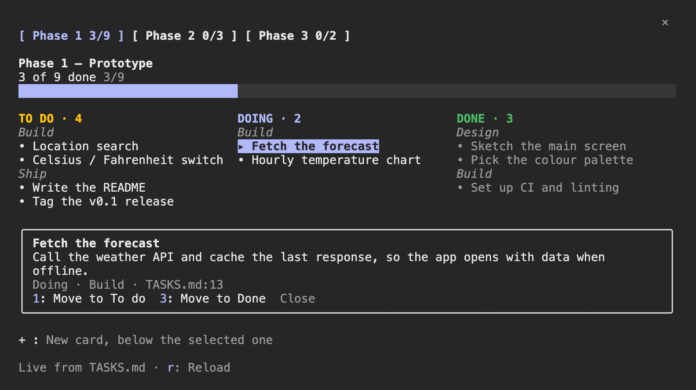

# roadmap-kanban

A Claude Code mod that draws a kanban board, in a pane beside the chat, over a
plain markdown task file in your project (`TASKS.md` by default). The file is
the only store: moving or adding a card rewrites the file, and edits you make
to it anywhere else show on the board within a second or two.



## Install

At the prompt of a Claude Code terminal session:

```
/plugin install roadmap-kanban --marketplace mbadaz/claude-kanban-board
```

Answer `y` to add the marketplace, then pick a scope (user, the first one,
installs it for every session).

From a shell:

```
claude plugin install roadmap-kanban --marketplace mbadaz/claude-kanban-board
```

In the desktop app, where `/plugin` does not run: click + next to the prompt
box, then Plugins, Add marketplace with `mbadaz/claude-kanban-board`, then Add plugin.

## Use

- `/kanban` opens the board. In a terminal at least 144 columns wide it also
  opens by itself when a session starts in a folder that has the task file.
- Each `## ` section with checkbox tasks is a tab. Each task is a card in
  **To do**, **Doing** or **Done**.
- Select a card to see its full text and its line in the file, then move it
  with the buttons or the keys `1`, `2` and `3`.
- Type in the `+` box to add a card below the selected one, or at the end of
  the stage when none is selected.
- `r` reloads the file.

## Tools for Claude

In a folder that has the task file, the mod also gives Claude six tools, so you
can ask for changes in plain words ("move the changelog card to doing", "add a
stage for the launch with these three tasks"):

| Tool | What it does |
|---|---|
| `list_tasks` | Lists the stages and cards, with each card's id, status, group and line |
| `add_task` | Adds a card to a stage, below a given card or at the end |
| `set_task_status` | Moves a card to to do, doing or done |
| `remove_task` | Deletes a card, with its continuation lines |
| `add_stage` | Adds a `## ` section with its first cards, at the end or after a stage |
| `remove_stage` | Deletes a stage; refuses while it has unfinished cards unless forced |

They use the board's own parser and editor, so they make the same minimal edits
and use the same card ids, and an edit to a card that changed since Claude
listed it is refused. Their edits show on the board at once. Claude Code asks
your permission the first time each one is used, as for any tool; the permission
rule `mcp__roadmap-kanban__*` allows them all.

## The task file

To point the board at another file (`ROADMAP.md`, say, or an absolute path),
set **Task file** in `/config`, or pass `--config file=ROADMAP.md` when
installing from a shell.

## The file format

```markdown
## Phase 2 — First release

**App**

- [ ] To do
- [/] Doing
- [x] Done. A card's text can run on
      over indented lines.
```

- A `## ` heading is a stage; sections that share a title are one stage.
- A line in bold on its own, or a `### ` heading, labels the cards below it.
  Labels that only name a status (Done, Remaining, To do…) are not drawn,
  since the columns already say so.
- `- [ ]`, `- [/]` and `- [x]` are to do, doing and done. GitHub draws `[/]`
  as plain text, not a checkbox.
- A card is its checkbox line plus the lines markdown folds into it. Checkboxes
  inside code blocks are ignored.

Edits change only the lines they must: a move rewrites one checkbox, and every
other byte of the file, line endings included, stays as it was. A card that was
changed in the file since the board last read it is not moved; the board
reloads and says so.

## Developing

```
claude plugin validate .
claude plugin test .
```

Type-checking needs the engine's types, which Claude Code writes into
`.claude-plugin/types/` the first time it loads the mod.
